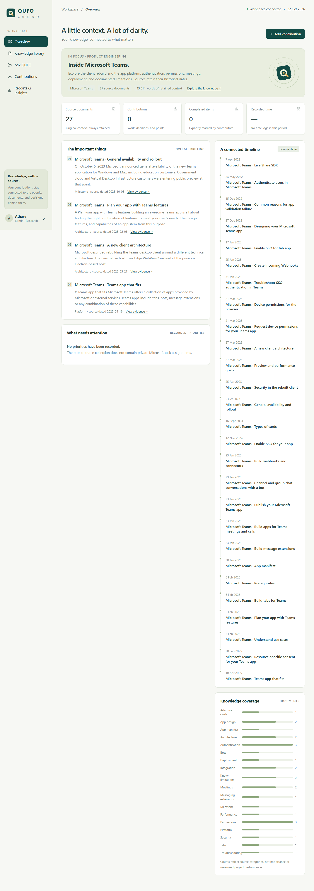
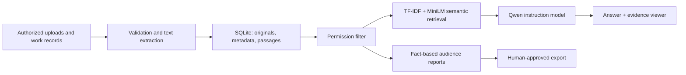

# QUFO — Quick Info

A company knowledge workspace that turns documents and work contributions into source-linked reports and detailed answers.

QUFO is an independent application. It has its own interface, backend, storage, AI pipeline, and desktop launcher.



## Screenshots and measured performance

[Browse the full screenshot gallery](docs/GALLERY.md): library, full documents, source-grounded chat, evidence connections, reports, contributions, and mobile layout.

On an NVIDIA RTX 4060 Laptop GPU, one measured question took **9.57 seconds cold** and **1.89?2.10 seconds warm**. These are end-to-end observations for one question, not a general benchmark. [Raw measurements](docs/gpu-performance.json).

Validation: **41 automated tests**, **28 curated retrieval checks**, and browser checks for upload, reports, exports, citations, follow-up questions, and mobile layout.

## Start

On Windows, double-click **SETUP.cmd** once. Setup installs dependencies, downloads the open AI models, and creates a **QUFO desktop shortcut**. Afterward, double-click that shortcut or **QUFO.cmd**. Closing the browser leaves QUFO running so it can prepare scheduled reports.

Python 3.11+ is required. The interface opens at http://127.0.0.1:8765. No Node.js build step or paid API is needed. Model downloads need internet initially; inference and document processing run on the machine afterward.

## Workspace accounts

| Username | Responsibility |
|---|---|
| atharv | Administrator |
| maya | Research team lead |
| alex | Research employee |
| jordan | Investor, Investment team |

On first setup, QUFO generates a different random password for each account and saves them in **data/initial-credentials.json** on your machine. Open that file to find your sign-in details; it is excluded from Git. Existing installations keep their existing accounts. For scripted setup, supply `QUFO_INITIAL_PASSWORD` through your environment; browser checks and the benchmark read `QUFO_PASSWORD`. Never commit these values.

These are application accounts, not Microsoft identities. Add deployment hardening before exposing the application to a network.

## What works

- Upload text-based PDF, DOCX, TXT, and Markdown files. Retain originals and indexed passages; reject unreadable or oversized documents and detect duplicate submissions.
- Employees, leaders, and investors can submit updates, tasks, issues, requirements, research, decisions, and points. Contributors explicitly record status, priority, deadlines, hours, INR costs, and pins.
- Company, team, and private visibility applies to document access, retrieval, chat, reports, and export selection.
- Role-oriented briefings show overall highlights, timelines, tasks, issues, completed items, decisions, knowledge coverage, and recorded time/cost.
- Ask follow-up questions with permission-scoped hybrid retrieval, source passages, and a compact local instruction model. Missing evidence produces an explicit abstention.
- Leads and administrators review selected items and explicitly approve a downloadable Markdown briefing. Nothing is automatically published externally.
- Daily briefings are generated after 18:00 Asia/Kolkata, with weekly briefings on Fridays while the server runs. Historical source material can be viewed using **All source history**.

## First collection: Microsoft Teams

The installed collection contains **27 sources and approximately 43,800 words**: four attributed research notes about the public client rebuild, plus **23 full official Microsoft documents** covering app design, authentication/SSO, tabs, meetings, Live Share, resource-specific consent, manifests, publishing, validation failures, bots, cards, and webhooks.

The full documentation is imported from a pinned pre-June-2025 revision of Microsoft's official repository. Searchable text removes front matter, comments and image markup; original Markdown bytes, revision IDs, dates, attribution, and the CC-BY-4.0 license are preserved. Embedded upstream code examples retain their separate MIT license. The client-rebuild notes and platform-development documents have different purposes; neither is a feed of private, current Microsoft employee work.

To reproduce the collection, run:
```powershell
.venv/Scripts/python.exe scripts/import_microsoft.py
```

Sources and license information: [source manifest](sources/microsoft-manifest.json), [engineering notes](sources/teams.json), and [upstream license](sources/licenses/msteams-docs-LICENSE.txt). Microsoft owns its original publications and trademarks. QUFO is not affiliated with Microsoft.

Chronology questions use explicit evidence rules: development start is different from public preview, product milestones are different from documentation revisions, and historical concerns are different from confirmed open work issues. Conversation scope is stored per signed-in session using document IDs and is rechecked against permissions every turn. Use **New conversation** to reset it.

Try questions such as: **How does SSO work? What is resource-specific consent? What are the limits of tabs? Why might Store validation fail? How do webhooks work?**

## AI architecture



- **NLP:** sentence-aware chunking, lexical features, source dates, explicit deadline/completion/issue/requirement signals, and structured work metadata.
- **Deep learning:** all-MiniLM-L6-v2 semantic embeddings and Qwen2.5-0.5B-Instruct in half precision.
- **RAG:** keyword/semantic retrieval combines scores over authorized passages; up to four passages feed the instruction model.
- **Generative AI:** on-demand evidence-constrained synthesis. The UI labels generated answers and displays the retrieved evidence. Model output is not guaranteed factual; generated statements are aligned to supplied passages by lexical similarity, and unsupported numbers are rejected. This is not a semantic entailment proof.
- **Reporting:** deterministic source-linked extraction and recorded metadata. Audience profiles prioritize different source categories; facts do not change by audience.
- **Inference runtime:** automatic NVIDIA CUDA inference when available, up to eight CPU preprocessing threads, one generation at a time, bounded context and generation time, no model fine-tuning, and no external inference calls.
- **Fallback:** if model assets are absent or inference fails, return labeled source excerpts rather than claiming an AI-generated answer. No models are silently downloaded during a request.

Full model weights and uploads are ignored by Git. The model downloader retains upstream license files. MiniLM and Qwen model cards identify Apache-2.0 licensing. Model revisions and runtime packages should be pinned after benchmarking for a long-lived deployment.

## Development and verification

```powershell
.venv/Scripts/python.exe server.py
.venv/Scripts/python.exe -m pytest tests -q
```

Tests use an isolated temporary database. No company data, generated reports, credentials from external services, model weights, or local databases belong in Git.

## Boundaries

This version has no external tool integrations, outbound messaging, autonomous task creation, OCR, or training pipeline. Document connections use permission-filtered text similarity; there is no separate graph database or neural reranker yet. Daily/weekly scheduling requires the application process to be running. Source text must be readable; scanned images require OCR before upload.

Public-facing hosting, multi-company tenancy, SSO, backup automation, and larger-model evaluations are future work. The current implementation does not claim those capabilities.

## Evidence of the build

See [verification results](docs/VALIDATION.md), the [architecture](docs/ARCHITECTURE.md), and [retrieval checks](docs/retrieval-results.json). An optional [workspace review note](examples/workspace-review.md) exercises source-linked upload signals without inventing Microsoft employee data.

## GPU acceleration

QUFO automatically uses CUDA for the language model and uncached embeddings when a compatible NVIDIA runtime is available. On Windows, setup detects the NVIDIA driver and installs matching PyTorch/torchvision CUDA wheels inside QUFO's environment. Downloads come from the official PyTorch endpoint and are checked against its published SHA-256 values. Other Python environments are unchanged.

Model weights stay resident between requests for faster subsequent answers. There is no continuous inference job while idle. Set QUFO_DEVICE=cpu to force CPU operation, or QUFO_DEVICE=cuda to require the GPU explicitly. QUFO_CPU_THREADS controls CPU preprocessing threads.

Run .venv/Scripts/python.exe scripts/benchmark_gpu.py with QUFO running to record cold/warm end-to-end times and actual model/embedding devices. First use includes library and model loading; later requests reuse loaded weights.
