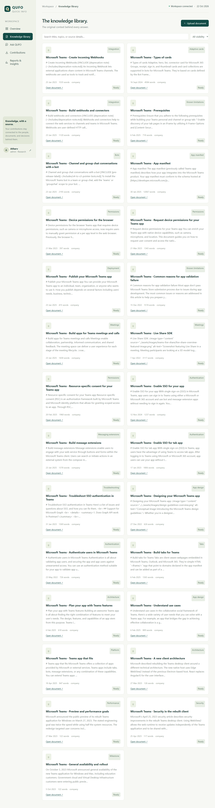
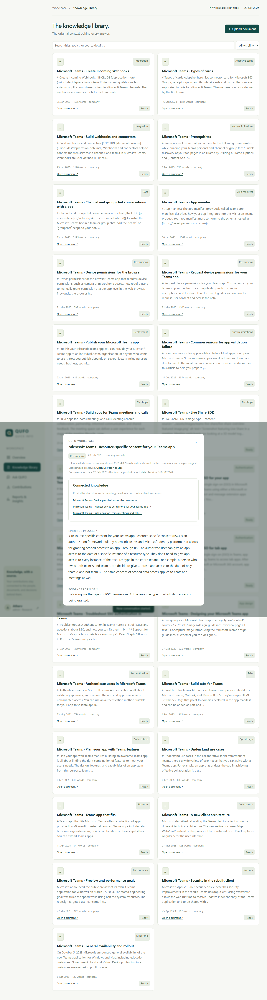
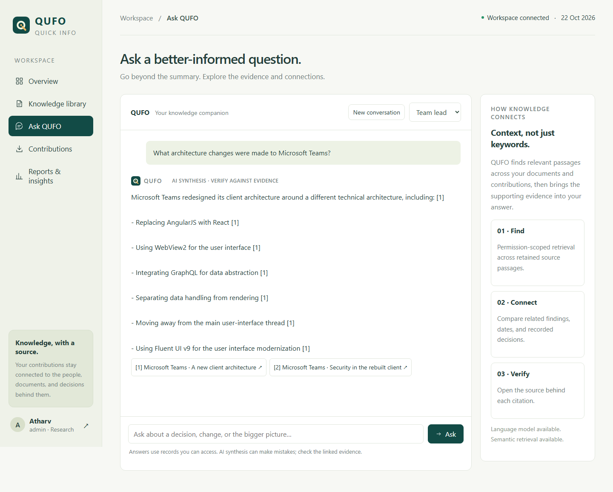
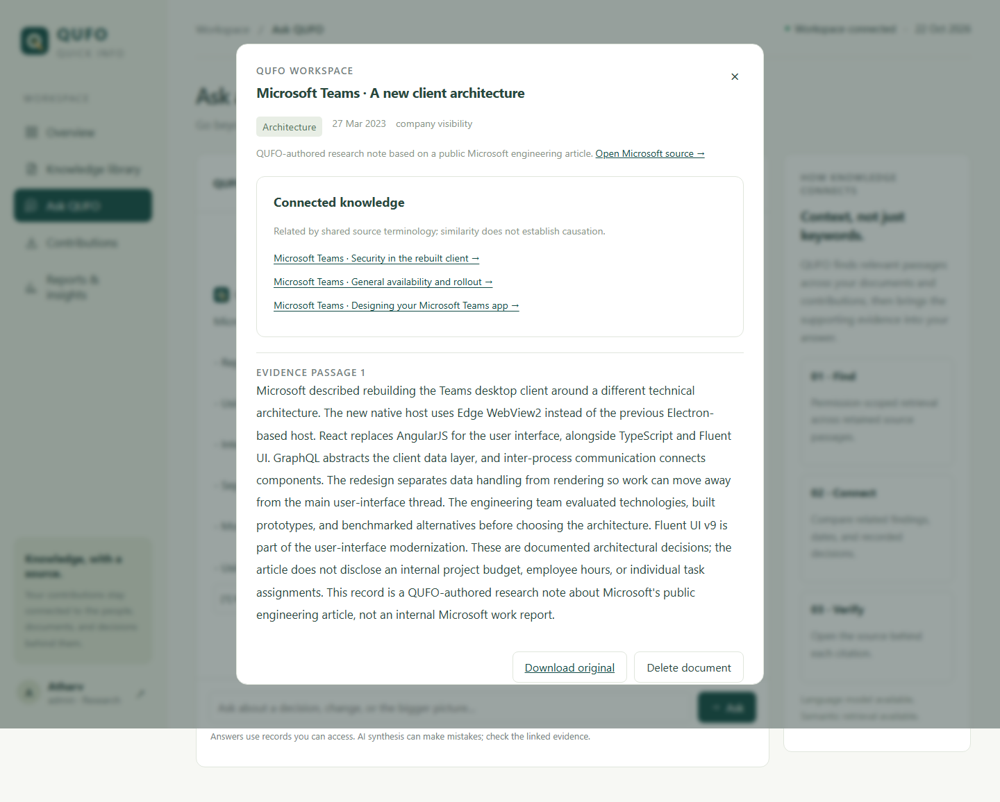
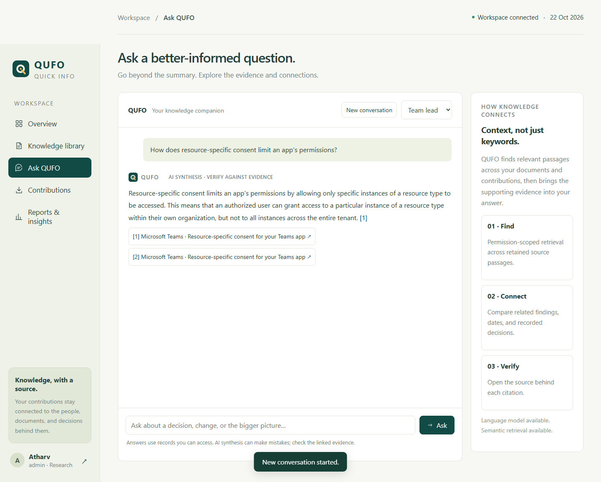
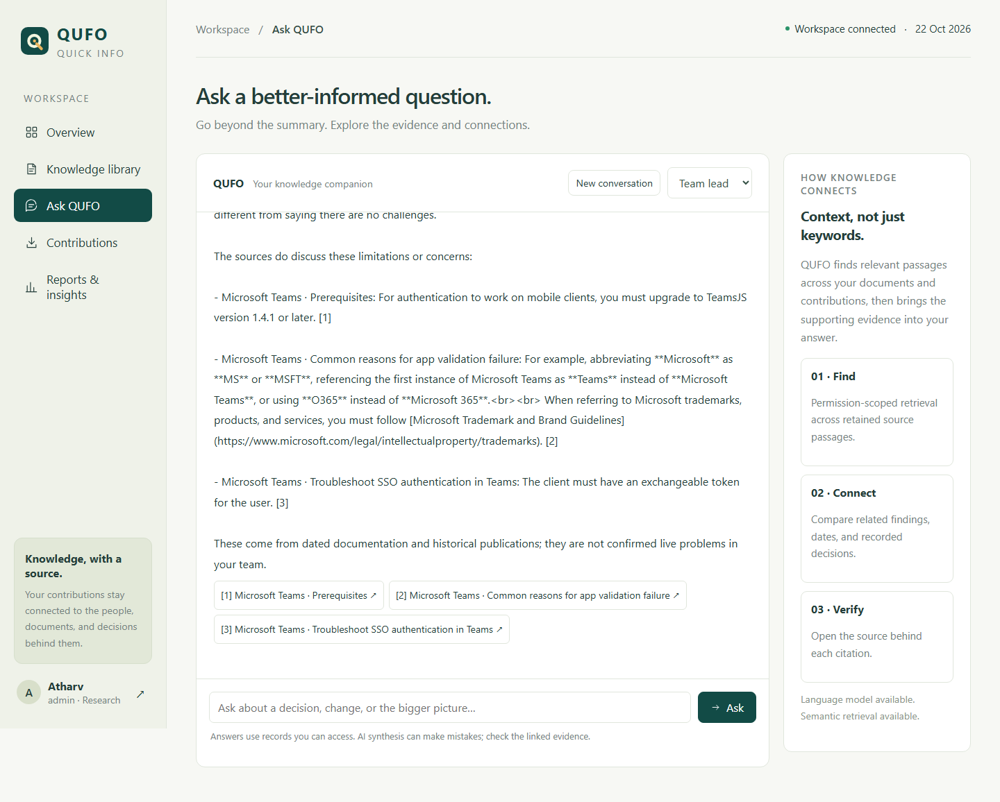
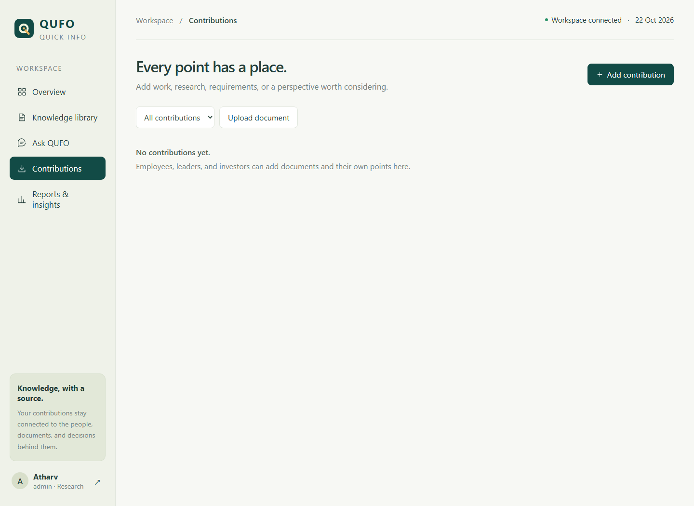
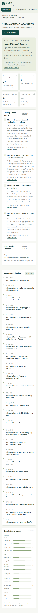

# QUFO screenshot gallery

Real application captures using the public Microsoft Teams collection. Screenshots show functionality; latency measurements are recorded separately in [GPU performance](gpu-performance.json).

## Workspace overview

## Public Microsoft Teams knowledge library

## Full document and upstream attribution

## Generated architecture answer with citations

## Evidence viewer and connected documents

## Detailed resource-specific consent answer

## Chronology and follow-up questions

## Structured work contributions

## Audience-specific reports

## Mobile workspace

